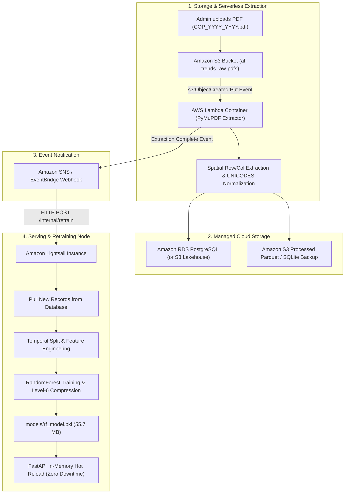

# Automated event-driven data extraction and retraining pipeline on AWS

## Executive summary and system architecture

This document defines an event-driven cloud architecture to automate the end-to-end lifecycle of the Sri Lanka Advanced Level (A/L) cutoff prediction platform. The system ingests official UGC PDF documents, automatically extracts and normalizes cutoff marks using serverless compute, updates a persistent cloud database, and triggers model retraining on an Amazon Lightsail instance.

In the current local implementation, ingestion, database updates, and model retraining are manually triggered through Dagster CLI commands. In the cloud architecture, uploading a new PDF to an Amazon S3 bucket triggers an AWS Lambda container function that executes spatial text extraction, stores normalized records in a managed cloud database, and notifies an Amazon Lightsail instance to retrain and hot-reload the Random Forest model.



---

## Cloud services selection rationale

Each AWS service is selected based on operational requirements, workload patterns, and cost efficiency.

### 1. Amazon S3 for raw document storage

UGC cutoff handbooks and seat capacity circulars are published intermittently, typically once or twice per academic cycle. 
- **Event-driven trigger**: S3 generates native `s3:ObjectCreated:*` event notifications with zero polling overhead.
- **Durability**: S3 offers 99.999999999% (11 9s) object durability, preserving original PDFs as the immutable bronze source of truth.
- **Cost**: Storing dozens of PDF files consumes less than 50 MB, incurring fractions of a cent per month.

### 2. AWS Lambda for serverless extraction

The PDF extraction task is compute-intensive for roughly 30 to 60 seconds during processing, but sits completely idle for the remainder of the year.
- **Zero idle cost**: Traditional EC2 instances run continuously and incur 24/7 billing. Lambda bills strictly for execution duration in 1-millisecond increments.
- **Container image support (up to 10 GB)**: The extraction engine relies on `pymupdf`, `pandas`, and layout processing tools that exceed the standard 50 MB zip deployment limit. Lambda container images allow packaging the exact Linux runtime environment.
- **Memory and CPU scalability**: Memory can be allocated up to 10 GB with proportional vCPU allocation, allowing PyMuPDF to parse dense multi-page tables in under 45 seconds.

### 3. Amazon RDS PostgreSQL vs. S3 SQLite synchronization

Two options exist for managing the centralized database on AWS:

| Dimension | Option A: Amazon RDS PostgreSQL (`db.t4g.micro`) | Option B: S3 Versioned SQLite Bucket |
|---|---|---|
| **Architecture** | Client-server managed relational database | Single-file embedded database synchronized via S3 |
| **Concurrency** | Full ACID concurrency with connection pooling | Single-writer, multi-reader lock semantics |
| **Cost** | ~$13/month (Free Tier eligible for 12 months) | < $0.10/month |
| **Operational complexity** | Requires VPC peering or secure public endpoint | Requires Lightsail to pull the updated `.db` file on event |
| **Recommendation** | Standard multi-user production systems | Budget-constrained or read-heavy single-node systems |

For standard production deployments, Amazon RDS PostgreSQL is the recommended choice. Lambda inserts normalized records via SQL transactions, and the Lightsail instance queries the database directly over a private or encrypted connection.

### 4. Amazon Lightsail for API serving and model retraining

AWS Lightsail is chosen over EC2 or ECS Fargate for hosting the application server and model retraining job.
- **Predictable flat-rate pricing**: Lightsail provides bundled compute, SSD storage, and generous monthly data transfer allocations (starting at $3.50 to $10/month). This eliminates variable bandwidth egress charges typical of standard EC2 and ECS.
- **Persistent compute and memory**: The FastAPI service requires persistent in-memory caching of the historical cutoff metadata (894 course-university-district pairs) and fast response times (< 30 ms). Running on a dedicated Lightsail instance avoids cold starts common to serverless HTTP APIs.
- **Compute capability for retraining**: Training the 100-tree Random Forest regressor on 6,000+ historical rows takes approximately 5 to 10 seconds of CPU time. A 2 GB RAM / 1 vCPU or 2 vCPU Lightsail instance executes training smoothly without memory pressure.

### 5. Amazon EventBridge / SNS for asynchronous dispatch

Direct synchronous HTTP coupling between Lambda and Lightsail creates tight dependency. If Lightsail is restarting or under load, the Lambda function could time out waiting for an HTTP response.
- **Decoupled execution**: Lambda publishes an "ExtractionSucceeded" event to Amazon EventBridge or Amazon SNS.
- **Retry policies and dead-letter queues**: SNS or EventBridge manages retries with exponential backoff if the Lightsail webhook endpoint is temporarily unreachable.

---

## Step-by-step implementation guide

### Step 1: Create Amazon S3 storage buckets

Create two S3 buckets in your target region (e.g., `us-east-1`):
1. `al-trends-raw-pdfs`: Receives raw PDF uploads from administrators or automated web scrapers.
2. `al-trends-artifacts`: Stores processed CSV/Parquet snapshots and backup model binaries.

Using the AWS CLI:

```bash
aws s3 mb s3://al-trends-raw-pdfs --region us-east-1
aws s3 mb s3://al-trends-artifacts --region us-east-1

# Enable versioning on raw bucket to preserve historical source files
aws s3api put-bucket-versioning \
    --bucket al-trends-raw-pdfs \
    --versioning-configuration Status=Enabled
```

### Step 2: Package the extraction engine into a Lambda container

Because `pymupdf`, `pandas`, and their underlying C-extensions exceed standard Lambda zip layer sizes, package the extraction engine as an OCI-compliant container image.

Create `Dockerfile.lambda`:

```dockerfile
FROM public.ecr.aws/lambda/python:3.11

# Copy dependency definition
COPY pyproject.toml requirements.txt ${LAMBDA_TASK_ROOT}/

# Install dependencies using pip inside Lambda task root
RUN pip install --no-cache-dir -r ${LAMBDA_TASK_ROOT}/requirements.txt psycopg2-binary boto3

# Copy application code
COPY src/ ${LAMBDA_TASK_ROOT}/src/

# Set the Lambda handler entrypoint
CMD [ "src.zscore_extractor.lambda_handler.handler" ]
```

Create the Lambda handler at `src/zscore_extractor/lambda_handler.py`:

```python
import os
import json
import boto3
import tempfile
import psycopg2
from pathlib import Path
from src.zscore_extractor.parsing import parse_pdf_cutoffs
from src.zscore_extractor.storage import transform_to_star_schema

s3_client = boto3.client("s3")
sns_client = boto3.client("sns")

DB_HOST = os.environ.get("DB_HOST")
DB_NAME = os.environ.get("DB_NAME", "al_trends")
DB_USER = os.environ.get("DB_USER")
DB_PASS = os.environ.get("DB_PASS")
SNS_TOPIC_ARN = os.environ.get("SNS_TOPIC_ARN")

def handler(event, context):
    """Processes newly uploaded UGC PDF files from S3 event notifications."""
    for record in event.get("Records", []):
        bucket_name = record["s3"]["bucket"]["name"]
        object_key = record["s3"]["object"]["key"]
        
        print(f"Processing new PDF upload: s3://{bucket_name}/{object_key}")
        
        # Download PDF to ephemeral Lambda /tmp storage
        with tempfile.NamedTemporaryFile(suffix=".pdf", delete=False) as tmp_file:
            s3_client.download_fileobj(bucket_name, object_key, tmp_file)
            tmp_path = Path(tmp_file.name)
            
        try:
            # 1. Parse table bounding boxes and extract rows
            raw_records = parse_pdf_cutoffs(tmp_path)
            print(f"Extracted {len(raw_records)} cutoff records from {object_key}")
            
            # 2. Transform into star schema fact and dimension records
            fact_df, dim_course, dim_uni, dim_dist, dim_year = transform_to_star_schema(raw_records)
            
            # 3. Write updates to Amazon RDS PostgreSQL
            conn = psycopg2.connect(
                host=DB_HOST,
                database=DB_NAME,
                user=DB_USER,
                password=DB_PASS,
                connect_timeout=10
            )
            with conn.cursor() as cur:
                # Upsert dimensions and append facts
                for _, row in fact_df.iterrows():
                    cur.execute("""
                        INSERT INTO fact_cutoffs (CourseID, UniversityID, DistrictID, YearID, CutoffZ)
                        VALUES (%s, %s, %s, %s, %s)
                        ON CONFLICT (CourseID, UniversityID, DistrictID, YearID) 
                        DO UPDATE SET CutoffZ = EXCLUDED.CutoffZ;
                    """, (row['CourseID'], row['UniversityID'], row['DistrictID'], row['YearID'], row['CutoffZ']))
                conn.commit()
            conn.close()
            print("Successfully updated RDS database records.")
            
            # 4. Notify downstream retraining subscriber via Amazon SNS
            if SNS_TOPIC_ARN:
                message = {
                    "event": "PDF_EXTRACTED_AND_LOADED",
                    "source_file": object_key,
                    "rows_inserted": len(fact_df),
                    "year": int(fact_df['YearID'].iloc[0]) if not fact_df.empty else None
                }
                sns_client.publish(
                    TopicArn=SNS_TOPIC_ARN,
                    Subject="AL Trends: New Data Extracted",
                    Message=json.dumps(message)
                )
                print(f"Published extraction event to SNS topic: {SNS_TOPIC_ARN}")
                
        finally:
            if tmp_path.exists():
                tmp_path.unlink()
                
    return {"statusCode": 200, "body": json.dumps("Extraction pipeline completed.")}
```

Build and push the container image to Amazon Elastic Container Registry (ECR):

```bash
# Authenticate Docker against ECR
aws ecr get-login-password --region us-east-1 | docker login --username AWS --password-stdin <AWS_ACCOUNT_ID>.dkr.ecr.us-east-1.amazonaws.com

# Create repository
aws ecr create-repository --repository-name al-trends-extractor --region us-east-1

# Build, tag, and push
docker build -f Dockerfile.lambda -t al-trends-extractor .
docker tag al-trends-extractor:latest <AWS_ACCOUNT_ID>.dkr.ecr.us-east-1.amazonaws.com/al-trends-extractor:latest
docker push <AWS_ACCOUNT_ID>.dkr.ecr.us-east-1.amazonaws.com/al-trends-extractor:latest
```

Create the Lambda function referencing the container image:

```bash
aws lambda create-function \
    --function-name al-trends-pdf-extractor \
    --package-type Image \
    --code ImageUri=<AWS_ACCOUNT_ID>.dkr.ecr.us-east-1.amazonaws.com/al-trends-extractor:latest \
    --role arn:aws:iam::<AWS_ACCOUNT_ID>:role/lambda-extraction-execution-role \
    --timeout 120 \
    --memory-size 2048 \
    --region us-east-1
```

### Step 3: Configure Amazon S3 bucket notification trigger

Allow S3 to invoke the Lambda function, then register the event notification rule:

```bash
# Grant S3 permission to invoke the Lambda function
aws lambda add-permission \
    --function-name al-trends-pdf-extractor \
    --statement-id s3-put-trigger \
    --action lambda:InvokeFunction \
    --principal s3.amazonaws.com \
    --source-arn arn:aws:s3:::al-trends-raw-pdfs

# Configure S3 event trigger for *.pdf uploads
cat <<EOF > s3_notification.json
{
  "LambdaFunctionConfigurations": [
    {
      "LambdaFunctionArn": "arn:aws:lambda:us-east-1:<AWS_ACCOUNT_ID>:function:al-trends-pdf-extractor",
      "Events": ["s3:ObjectCreated:*"],
      "Filter": {
        "Key": {
          "FilterRules": [
            {
              "Name": "suffix",
              "Value": ".pdf"
            }
          ]
        }
      }
    }
  ]
}
EOF

aws s3api put-bucket-notification-configuration \
    --bucket al-trends-raw-pdfs \
    --notification-configuration file://s3_notification.json
```

### Step 4: Configure Amazon SNS topic for retraining dispatch

Create an Amazon SNS topic to publish extraction events:

```bash
aws sns create-topic --name al-trends-retrain-topic --region us-east-1
# Returns: arn:aws:sns:us-east-1:<AWS_ACCOUNT_ID>:al-trends-retrain-topic
```

Attach the topic ARN as an environment variable to the Lambda function:

```bash
aws lambda update-function-configuration \
    --function-name al-trends-pdf-extractor \
    --environment "Variables={DB_HOST=al-trends-db.<id>.us-east-1.rds.amazonaws.com,DB_NAME=al_trends,DB_USER=postgres,DB_PASS=YourSecurePass,SNS_TOPIC_ARN=arn:aws:sns:us-east-1:<AWS_ACCOUNT_ID>:al-trends-retrain-topic}"
```

### Step 5: Implement the retraining webhook on Lightsail

On the Amazon Lightsail instance, configure the FastAPI backend to expose an authenticated internal endpoint that receives notifications from SNS and initiates background model retraining.

Add the retraining endpoint to `src/api/main.py`:

```python
import os
import json
from fastapi import APIRouter, Header, HTTPException, BackgroundTasks, status
from starlette.requests import Request
from starlette.responses import Response

router = APIRouter(prefix="/internal", tags=["Internal Ops"])

RETRAIN_SECRET_TOKEN = os.getenv("RETRAIN_SECRET_TOKEN", "generate_a_random_32_byte_secret")

def execute_model_retraining():
    """Executes model retraining, writes compressed artifact, and reloads in-memory service."""
    global ml_service
    import joblib
    import sqlite3
    import pandas as pd
    from sklearn.ensemble import RandomForestRegressor
    from sklearn.preprocessing import OrdinalEncoder
    
    print("[RETRAIN] Pulling updated records from database...")
    # Read updated data from SQLite or RDS PostgreSQL
    conn = sqlite3.connect("data/bronze/db/al_cutoffs.db")
    query = """
    SELECT c.CourseName, u.UniversityName, d.DistrictName, y.ExamYear, f.CutoffZ
    FROM fact_cutoffs f
    JOIN dim_course c ON f.CourseID = c.CourseID
    JOIN dim_university u ON f.UniversityID = u.UniversityID
    JOIN dim_district d ON f.DistrictID = d.DistrictID
    JOIN dim_year y ON f.YearID = y.YearID
    WHERE f.CutoffZ IS NOT NULL
    """
    df = pd.read_sql(query, conn)
    conn.close()
    
    print(f"[RETRAIN] Training Random Forest on {len(df)} records...")
    encoder = OrdinalEncoder(handle_unknown='use_encoded_value', unknown_value=-1)
    df[['Course_Enc', 'Uni_Enc', 'Dist_Enc']] = encoder.fit_transform(
        df[['CourseName', 'UniversityName', 'DistrictName']]
    )
    
    # Train model on all historical cohorts
    X = df[['ExamYear', 'Course_Enc', 'Uni_Enc', 'Dist_Enc']]
    y = df['CutoffZ']
    
    model = RandomForestRegressor(n_estimators=100, random_state=42, n_jobs=-1)
    model.fit(X, y)
    
    # Save with level-6 zlib compression
    os.makedirs("models", exist_ok=True)
    joblib.dump(model, "models/rf_model.pkl", compress=6)
    joblib.dump(encoder, "models/encoders.pkl")
    print(f"[RETRAIN] Compressed model persisted ({os.path.getsize('models/rf_model.pkl') / 1024 / 1024:.2f} MB)")
    
    # Hot-reload in-memory model in running FastAPI service without restarting server
    if ml_service is not None:
        ml_service.load_artifacts()
        ml_service.load_database_metadata()
        print("[RETRAIN] In-memory model and metadata cache reloaded successfully.")

@router.post("/retrain", summary="Trigger Automated Retraining")
async def trigger_retrain(
    request: Request,
    background_tasks: BackgroundTasks,
    x_retrain_token: str = Header(None)
):
    # Authenticate webhook caller
    if x_retrain_token != RETRAIN_SECRET_TOKEN:
        raise HTTPException(
            status_code=status.HTTP_401_UNAUTHORIZED,
            detail="Invalid or missing retraining authentication token."
        )
    
    body_bytes = await request.body()
    try:
        body = json.loads(body_bytes.decode("utf-8"))
        # Handle Amazon SNS subscription confirmation handshake
        if body.get("Type") == "SubscriptionConfirmation":
            subscribe_url = body.get("SubscribeURL")
            import httpx
            async with httpx.AsyncClient() as client:
                await client.get(subscribe_url)
            return {"status": "Subscription confirmed successfully."}
    except Exception:
        pass
        
    # Queue retraining in background so webhook returns immediate HTTP 202
    background_tasks.add_task(execute_model_retraining)
    return {"status": "accepted", "message": "Model retraining task queued in background."}
```

Subscribe the Lightsail endpoint to the Amazon SNS topic:

```bash
aws sns subscribe \
    --topic-arn arn:aws:sns:us-east-1:<AWS_ACCOUNT_ID>:al-trends-retrain-topic \
    --protocol https \
    --notification-endpoint https://your-lightsail-domain.com/internal/retrain
```

Amazon SNS sends an automated confirmation request to the endpoint. The endpoint verifies the handshake and activates the subscription automatically.

---

## End-to-end execution flow

```
1. Administrator uploads 'COP_2026_2027.pdf' to S3 bucket 'al-trends-raw-pdfs'.
   │
2. S3 triggers AWS Lambda container 'al-trends-pdf-extractor'.
   │
3. Lambda downloads PDF to /tmp, executes spatial table parsing via PyMuPDF.
   │
4. Lambda matches courses and universities against canonical UNICODES.
   │
5. Extracted fact and dimension records are committed to Amazon RDS PostgreSQL.
   │
6. Lambda publishes success notification payload to Amazon SNS topic.
   │
7. Amazon SNS sends signed HTTP POST to Lightsail '/internal/retrain' webhook.
   │
8. Lightsail backend verifies token and starts background training thread:
   ├── Queries updated records from database
   ├── Trains RandomForestRegressor(n_estimators=100)
   ├── Compresses artifact to 'models/rf_model.pkl' (55.7 MB) via joblib
   └── Calls ml_service.load_artifacts() to reload model into RAM
   │
9. Client prediction requests to '/predict' immediately reflect updated parameters
   with zero downtime.
```

---

## Security and operational considerations

1. **IAM least privilege**:
   - The Lambda execution role has read-only access to `arn:aws:s3:::al-trends-raw-pdfs/*` and publish-only access to the SNS topic.
   - RDS security groups restrict inbound port 5432 strictly to the Lambda security group and the Lightsail static IP address.

2. **Zero-downtime hot reloading**:
   - Model retraining executes in a Python `BackgroundTasks` thread. The running FastAPI event loop continues serving incoming prediction requests with the existing model instance.
   - Once training completes, the service instance atomically swaps the object reference (`self.model = joblib.load(...)`), avoiding process termination or container restarts.

3. **Cost ceiling**:
   - S3 Storage: < $0.05 / month
   - AWS Lambda: Free Tier eligible (under 1 million requests and 3.2 million seconds of compute time monthly)
   - Lightsail Node: $3.50 – $10.00 / month flat rate (includes compute, SSD, and data transfer allowance)
   - Estimated monthly total: **$3.55 to $10.05 / month** (excluding optional RDS, or free using versioned S3 database synchronization).
