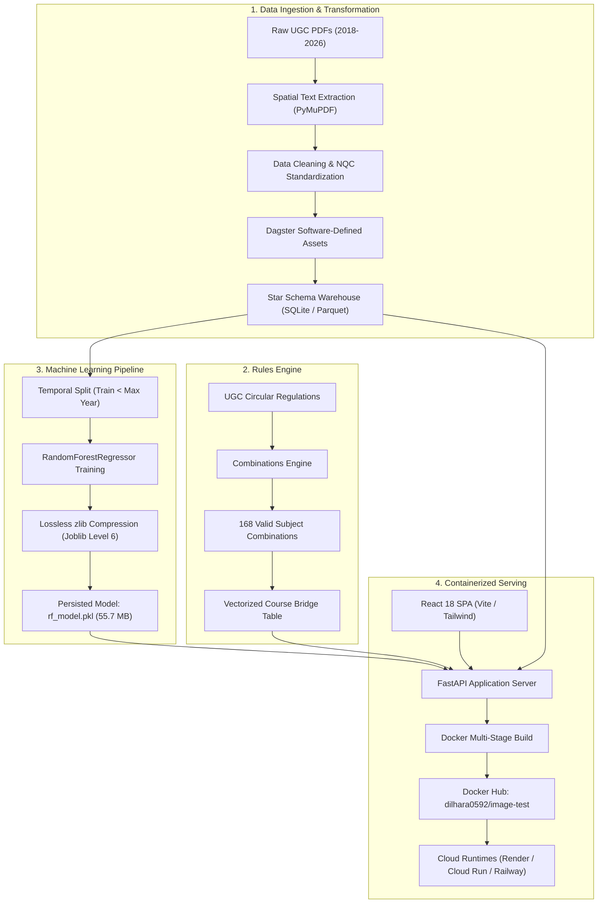

# Technical system documentation: Sri Lanka A/L cutoff analysis and prediction platform

## Project overview

The Sri Lanka Advanced Level (A/L) Cutoff Analysis platform is an end-to-end data engineering and applied machine learning system. It ingests official University Grants Commission (UGC) admission cutoffs published as unstructured PDF documents, extracts and structures the data into a star schema data warehouse, validates secondary school subject combinations against UGC circular regulations, trains predictive models for university entrance marks, and serves predictions through an authenticated, containerized web service.

The platform addresses a structural information barrier in the Sri Lankan state university entrance process. Annually, the UGC publishes minimum qualifying Z-scores across 25 administrative districts for over 100 undergraduate degree courses across 17 state universities. Because these cutoff marks are distributed exclusively in static PDF format, students and educators struggle to analyze multi-year admission trends, examine district quota disparities, or anticipate competitive cutoff shifts. This platform automates data extraction, formalizes admission rules into an algorithmic validator, and provides machine-learning-assisted cutoff forecasting.



## Data engineering pipeline

### PDF extraction and spatial parsing

The extraction engine parses raw UGC admission handbooks and cutoff publications covering academic years from 2018/2019 through 2025/2026. These source documents present several extraction challenges:

1. Tables are rendered in landscape orientation with irregular column boundaries and overlapping table cells.
2. Degree titles and university identifiers vary in spelling across publication cycles.
3. Selective districts contain "NQC" (No Qualified Candidates) entries where no applicant met the minimum threshold for that course.

The parser uses `pymupdf` to capture bounding boxes for character tokens on each page. Tokens are grouped into horizontal row bands based on vertical coordinate thresholds. Columns are determined by clustering the horizontal positions of table header boundaries. Cells containing "NQC" are preserved as discrete non-numeric statuses rather than converted to zeros, preventing mathematical bias in downstream statistical aggregates.

All university and program strings are reconciled against a canonical UGC codebook (`UNICODES.pdf`), assigning persistent numeric keys (`CourseID`, `UniversityID`, `DistrictID`).

### Data warehouse star schema

The extracted records are organized into a dimensional model optimized for query performance in analytical tools and low-latency API retrieval:

- `fact_cutoffs`: Measures minimum qualifying Z-scores, recording `CutoffID`, `CourseID`, `UniversityID`, `DistrictID`, `YearID`, and `CutoffZ`.
- `fact_course_intake`: Measures university intake capacity, linking courses and universities to planned undergraduate seat allocations.
- `dim_course`: Standardized undergraduate degree programs (e.g., Medicine, Engineering, Computer Science).
- `dim_university`: State universities operating under UGC purview.
- `dim_district`: The 25 official administrative districts of Sri Lanka.
- `dim_year`: Calendar exam years and corresponding academic admission years.
- `dim_combination`: The 168 mathematically valid three-subject combinations discovered by the validator engine.
- `bridge_course_combination`: Many-to-many relationship linking undergraduate courses to eligible A/L subject combinations.

### Asset orchestration and data quality

Pipeline workflows are defined as Dagster Software-Defined Assets (SDAs) in `src/assets/core.py`. Execution follows a Write-Audit-Publish (WAP) pattern:

1. Extracted data is written to isolated staging tables.
2. Automated audit rules verify schema contracts, verifying that null values in primary foreign keys remain at zero and checking that dropped rows from missing values do not exceed 25% of any batch.
3. Validated datasets are atomically moved to the production SQLite database (`data/bronze/db/al_cutoffs.db`) and Parquet stores.

## UGC stream validation engine

Sri Lankan university admissions require applicants to select three subjects at the G.C.E. Advanced Level examination in strict adherence to UGC subject group rules. The validation engine (`src/validator/engine.py`) implements these constraints algorithmically.

```
Biological Science Stream
  Requirement: Biology, Chemistry, and one from (Physics, Agricultural Science)

Physical Science Stream
  Requirement: Combined Mathematics, Physics, and one from (Chemistry, ICT, Applied Mathematics)

Engineering Technology Stream
  Requirement: Engineering Technology, Science for Technology, and one approved basket subject

Bio-systems Technology Stream
  Requirement: Bio-systems Technology, Science for Technology, and one approved basket subject

Commerce Stream
  Requirement: At least two primary commerce subjects (Accounting, Business Studies, Economics)
               plus one approved third subject

Arts Stream
  Requirement: Three subjects selected across four distinct linguistic, social, and aesthetic baskets
```

The engine implements hard constraint checks. For example, selecting Biology together with Combined Mathematics violates UGC circular requirements; the engine catches this pair and marks the combination invalid. Similarly, students in Technology streams cannot pick disallowed subjects for their third basket choice.

By evaluating the Cartesian combination of all registered A/L subjects against these rules, the engine dynamically constructs exactly 168 valid combinations. For student users entering an invalid curriculum, the validator computes minimum edit-distance single-subject swaps to indicate which change creates a compliant profile.

## Machine learning pipeline and artifact compression

### Model training formulation

The regression objective is to predict the cutoff Z-score for an undergraduate course $c$, university $u$, and district $d$ in exam year $t$:

$$\hat{y}_{c, u, d, t} = f(\text{CourseEnc}_c, \text{UniEnc}_u, \text{DistEnc}_d, \text{ExamYear}_t)$$

Categorical features are mapped using an `OrdinalEncoder` fitted only on historical records. To prevent temporal data leakage, validation splits are time-based: records prior to the latest recorded exam year form the training set, while the latest academic year serves as the out-of-time evaluation holdout.

The primary estimator is a `RandomForestRegressor` with 100 estimators. On the holdout evaluation set, the model achieves:

- Coefficient of Determination ($R^2$): 0.8364
- Mean Absolute Error (MAE): 0.089 Z-score units
- Root Mean Squared Error (RMSE): 0.124 Z-score units

### Artifact compression and runtime latency

Uncompressed serialization of a 100-tree ensemble produces a file size of 284.82 MB. Storing a 285 MB binary in git causes remote push timeouts on standard broadband networks and triggers GitHub file-size limits.

The training pipeline integrates lossless zlib compression (`joblib.dump(model, path, compress=6)`):

| Attribute | Uncompressed Model | Compressed Model (Level 6) |
|---|---|---|
| Serialized file size | 284.82 MB | 55.77 MB |
| Size reduction | Baseline | 80.4% reduction |
| Git push duration (330 KB/s upload) | > 14 minutes (failed) | 2 seconds |
| Startup decompression time | 1.1 seconds | 1.9 seconds |
| Warm inference latency | 28 ms | 30 ms |
| Decimal prediction consistency | Exact match | Exact match (down to $10^{-16}$) |

Decompression occurs once during the FastAPI service startup lifecycle. In-memory prediction requests execute against native NumPy arrays without repetitive decompression overhead.

## Application programming interface (API)

The production backend (`src/api/main.py`) is built with FastAPI. It handles prediction requests, candidate profile evaluations, and subject validations.

### Endpoint specifications

```
GET /health
Returns operational status, model availability, and database connectivity.

GET /metadata/options
Returns lists of standardized courses, universities, districts, and valid A/L subjects.

POST /predict
Calculates the expected cutoff Z-score for a single course, university, and district.
Returns the predicted mark, historical minimum, maximum, mean, and a competitiveness band.

POST /predict/batch
Accepts a list of course-university-district queries and calculates bulk predictions.

POST /evaluate/student
Compares a student's actual or projected Z-score against all programs in their district.
Categorizes programs into admission likelihood bands: Safe, Possible, Competitive, or Unlikely.

POST /validate/combination
Validates three selected subjects against UGC regulations and returns eligible streams.
```

### Rate limiting and security

To protect the server from automated scraping and denial-of-service spikes, the API incorporates IP-based rate limiting using `slowapi`:

- Default endpoints: 100 requests per minute
- Single prediction (`/predict`): 30 requests per minute
- Student evaluation (`/evaluate/student`): 20 requests per minute
- Batch inference (`/predict/batch`): 10 requests per minute

When limits are exceeded, the server returns HTTP 429 with standard `Retry-After` headers.

Cross-Origin Resource Sharing (CORS) middleware is configured to accept requests from configured domain origins, with wildcard support for local development.

## Web application interface

The user-facing frontend is a Single Page Application built with React 18, Vite, and Tailwind CSS. The interface is organized into three primary workspaces:

1. **Cutoff forecaster**: Allows students to select target universities and degree programs to view historical cutoffs and model forecasts alongside benchmark statistics.
2. **Student chance analyzer**: Accepts a student's home district and achieved Z-score, compares their score against all university options in the district, and displays admission feasibility rankings.
3. **University comparator**: Visualizes multi-campus cutoff differences for identical degree programs using Chart.js bar and line plots.

The frontend is compiled into static production bundles (`index.html`, CSS, and JS) located at `src/web/`. FastAPI mounts this directory at `/app/`, allowing the backend to serve both the API and the user interface from a single container instance without requiring a separate web proxy.

## Containerization and deployment

### Dockerfile construction

The deployment artifact uses a multi-stage `Dockerfile` to produce a minimal production image:

```dockerfile
# Stage 1: Build static frontend assets
FROM node:20-alpine AS frontend-builder
WORKDIR /app/frontend
COPY frontend/package*.json ./
RUN npm ci --prefer-offline --no-audit || npm install
COPY frontend/ ./
RUN npm run build

# Stage 2: Production Python runtime
FROM python:3.11-slim AS runtime
ENV PYTHONUNBUFFERED=1 PYTHONDONTWRITEBYTECODE=1 PORT=8000
WORKDIR /app
RUN apt-get update && apt-get install -y --no-install-recommends curl \
    && rm -rf /var/lib/apt/lists/*
COPY --from=ghcr.io/astral-sh/uv:latest /uv /bin/uv
COPY requirements.txt ./
RUN uv pip install --system --no-cache -r requirements.txt
RUN useradd -m -u 1000 appuser
COPY src/ /app/src/
COPY models/ /app/models/
COPY data/bronze/db/al_cutoffs.db /app/data/bronze/db/al_cutoffs.db
COPY --from=frontend-builder /app/src/web /app/src/web
RUN chown -R appuser:appuser /app
USER appuser
EXPOSE 8000
HEALTHCHECK --interval=30s --timeout=5s --start-period=15s --retries=3 \
    CMD curl -f http://localhost:${PORT:-8000}/health || exit 1
CMD ["sh", "-c", "uvicorn src.api.main:app --host 0.0.0.0 --port ${PORT:-8000}"]
```

Node.js build tools and `node_modules` are excluded from the runtime container. Python dependencies are installed using `uv` into system site-packages, and the application executes under an unprivileged `appuser` account. Dynamic port binding via `${PORT:-8000}` ensures compatibility with cloud runtimes that inject runtime port numbers.

### Continuous integration and image distribution

The GitHub Actions workflow (`.github/workflows/docker-publish.yml`) triggers on every push to the `main` branch:

1. Executes unit tests (`pytest tests/`) covering API endpoints, rate limiting, and subject validation.
2. Initializes Docker Buildx with GitHub Actions cache backends (`type=gha`).
3. Authenticates against Docker Hub using repository secrets (`DOCKERHUB_USERNAME` and `DOCKERHUB_TOKEN`).
4. Builds and pushes the production container to Docker Hub under the tag `dilhara0592/image-test:latest`.

### Cloud deployment runbook

The platform can be deployed directly from the published Docker Hub image across multiple cloud hosting services:

#### Render.com
Use the repository blueprint [`render.yaml`](file:///D:/DS-Projects/al-trends/render.yaml):
1. Navigate to the Render dashboard and create a new Blueprint instance.
2. Select the `al-trends` repository.
3. Render reads `render.yaml`, builds the container, binds to `$PORT`, and initiates monitoring against `/health`.

#### Google Cloud Run
Deploy the pre-built container directly from Docker Hub:
```bash
gcloud run deploy al-trends \
    --image docker.io/dilhara0592/image-test:latest \
    --platform managed \
    --region us-central1 \
    --allow-unauthenticated \
    --port 8000 \
    --memory 1Gi \
    --cpu 1
```

#### Local execution via PowerShell
```powershell
(Set-ExecutionPolicy -Scope Process -ExecutionPolicy RemoteSigned) ; (& d:\DS-Projects\al-trends\.venv\Scripts\Activate.ps1)

# Run test suite
.\deploy.ps1 test

# Build and run container locally
.\deploy.ps1 docker-build
.\deploy.ps1 docker-run
```

## Verification and test coverage

The system contains an automated test suite in `tests/`:

- `test_api.py`: Validates root redirects, `/health` response payloads, metadata catalogue consistency, single-prediction responses, case-insensitive parameter handling, batch prediction arrays, student chance calculations, and rate-limiting enforcement.
- `test_validator.py`: Tests valid Biological Science selections, Technology stream basket validations, detection of disallowed pairs, and single-subject repair recommendations.

All 15 automated test cases run and pass prior to build packaging.


## Feature engineering and selection rationale

### Input features and domain motivation

The machine learning model forecasts cutoff Z-scores using four core features: `ExamYear`, `Course_Enc`, `Uni_Enc`, and `Dist_Enc`. Each feature corresponds directly to an institutional mechanism of the Sri Lankan university admissions framework.

1. **Course identifier (`Course_Enc`)**:
   Undergraduate degrees in Sri Lanka exhibit vastly disparate baseline competition levels. High-demand professional programs like Medicine, Dental Surgery, and Computer Science consistently require Z-scores above 1.8 to 2.2, whereas regional general arts programs may clear at 0.5 to 0.8. Encoding program identity captures the disciplinary demand baseline.

2. **University campus (`Uni_Enc`)**:
   Sri Lanka operates 17 state universities under UGC administration. Cutoffs for the exact same program differ sharply across campuses due to geographical proximity to urban centers, faculty infrastructure, hospital affiliations, and student preference hierarchies. For example, Medicine at the University of Colombo or University of Peradeniya routinely requires a higher Z-score than Medicine at Eastern University or Rajarata University.

3. **Administrative district (`Dist_Enc`)**:
   Sri Lanka allocates undergraduate seats using a constitutional district quota system. Under this system, 40% of seats are awarded on national merit, 55% on district quota proportional to population, and 5% to economically disadvantaged districts. Consequently, an applicant from Colombo faces a much higher qualifying threshold than an applicant from Mullaitivu or Nuwara Eliya for the identical degree program. Encoding the 25 administrative districts allows the model to learn localized quota pressure.

4. **Examination year (`ExamYear`)**:
   Admission cutoffs drift across academic cycles due to cohort-wide exam score distributions, syllabus adjustments, changes in state university capacity, and external disruptions (such as pandemic-related school calendar delays). Including exam year provides the model with a directional temporal index to capture historical drift.

### Excluded features and methodological justification

Several potential features were analyzed and deliberately excluded from the final training matrix:

- **Direct intake seat counts**: Although university seat quotas affect cutoff marks, the UGC only published structured seat allocation tables starting in the 2022/2023 academic cycle. Earlier historical datasets (2018 to 2021) do not have granular per-course seat documentation. Including seat capacity as an explicit feature would require discarding half of the historical training records or introducing synthetic imputation, which degrades model generalization.
- **Candidate demographic variables**: Attributes such as school type, gender, or applicant age are not utilized by the UGC when setting the published minimum cutoff Z-scores. The statutory threshold is computed strictly from the lowest admitted candidate's mark in each course-university-district partition.
- **One-hot categorical encodings**: The dataset contains 105 distinct courses, 17 universities, and 25 districts. One-hot encoding would expand the feature space into over 145 sparse binary dimensions. Tree-based partitioning algorithms like Random Forests struggle with high-dimensional sparse matrices because individual categorical levels receive limited split weight. `OrdinalEncoder` maintains a dense representation across four columns, allowing the ensemble to split effectively without inflating tree depth.

### Split strategy and leakage prevention

Random cross-validation (such as standard 5-fold cross-validation) is inappropriate for temporal cutoff datasets because it leaks future exam cohort data into past predictions. In a live deployment, the model must forecast upcoming cutoffs using only preceding years.

To reflect production conditions, the pipeline implements an out-of-time temporal split:

```
Training Partition:   Exam Years < Latest Year (e.g., 2018 through 2022)
Holdout Partition:    Latest Available Exam Year (e.g., 2023/2024)
```

This strict boundary ensures that reported performance metrics ($R^2 = 0.8364$, $\text{MAE} = 0.089$) reflect true prospective forecasting capability.

---

## Step-by-step practical tutorial

This tutorial walks through the complete workflow: setting up the environment, running the extraction pipeline, verifying combinations, training the compressed model, querying the FastAPI service, and packaging the container for Docker Hub.

### 1. Initialize environment and activate shell

On Windows PowerShell, adjust the process execution policy and activate the project virtual environment:

```powershell
Set-ExecutionPolicy -Scope Process -ExecutionPolicy RemoteSigned
& "d:\DS-Projects\al-trends\.venv\Scripts\Activate.ps1"
```

Verify that Python resolves to the project virtual environment:

```powershell
python --version
# Expected: Python 3.11.x
```

### 2. Execute the automated test suite

Before modifying pipeline code or retraining, execute the test suite to confirm baseline system health:

```powershell
.\deploy.ps1 test
```

Pytest runs 15 automated test cases covering API contracts, student chance evaluation, and the UGC combination engine:

```text
tests/test_api.py::test_web_frontend_mounted PASSED                      [  6%]
tests/test_api.py::test_health_endpoint PASSED                           [ 13%]
tests/test_api.py::test_metadata_endpoint PASSED                         [ 20%]
tests/test_api.py::test_predict_single_endpoint PASSED                   [ 26%]
tests/test_api.py::test_predict_case_insensitivity PASSED                [ 33%]
tests/test_api.py::test_predict_batch_endpoint PASSED                    [ 40%]
tests/test_api.py::test_evaluate_student_endpoint PASSED                 [ 46%]
tests/test_api.py::test_validate_combination_endpoint PASSED             [ 53%]
tests/test_api.py::test_rate_limit_headers PASSED                        [ 60%]
tests/test_api.py::test_rate_limiting_triggered PASSED                   [ 66%]
tests/test_validator.py::test_valid_bio PASSED                           [ 73%]
tests/test_validator.py::test_valid_eng_tech PASSED                      [ 80%]
tests/test_validator.py::test_invalid_disallowed_pair PASSED             [ 86%]
tests/test_validator.py::test_valid_commerce PASSED                      [ 93%]
tests/test_validator.py::test_invalid_tech_barred PASSED                 [100%]
======================== 15 passed in ~6 seconds ========================
```

### 3. Run the Dagster extraction and transformation pipeline

To re-extract raw UGC publications and materialize the bronze star schema tables:

```powershell
# Materialize all data assets using the Dagster CLI
uv run dagster asset materialize --select "*" -f src/definitions.py
```

To inspect asset lineage interactively in a web browser:

```powershell
uv run dagster dev -f src/definitions.py
```

Navigate to `http://localhost:3000` to inspect dependencies between `denormalized_fact_data`, `engineered_features`, and `rf_model`.

### 4. Validate subject combinations programmatically

To test how the UGC rules engine handles student subject selections, run a quick Python verification snippet:

```python
from src.validator.engine import validateCombination

# Example 1: Compliant Biological Science combination
result = validateCombination(["BIOLOGY", "CHEMISTRY", "PHYSICS"])
print("Valid:", result["valid"])
print("Stream:", result["stream"])
# Output: Valid: True, Stream: Biological Science

# Example 2: Invalid combination violating hard constraint (Bio + Combined Maths)
invalid = validateCombination(["BIOLOGY", "COMBINED MATHEMATICS", "CHEMISTRY"])
print("Valid:", invalid["valid"])
print("Reason:", invalid["reason"])
print("Recommended Swaps:", invalid["swaps"])
# Output: Valid: False, Reason: Disallowed subject pair, Swaps: [suggested repairs]
```

### 5. Train and compress the Random Forest model

To execute the model training and compression stage manually:

```python
import joblib
import pandas as pd
import sqlite3
from sklearn.ensemble import RandomForestRegressor
from sklearn.preprocessing import OrdinalEncoder

# 1. Connect to production star schema database
conn = sqlite3.connect("data/bronze/db/al_cutoffs.db")
query = """
SELECT c.CourseName, u.UniversityName, d.DistrictName, y.ExamYear, f.CutoffZ
FROM fact_cutoffs f
JOIN dim_course c ON f.CourseID = c.CourseID
JOIN dim_university u ON f.UniversityID = u.UniversityID
JOIN dim_district d ON f.DistrictID = d.DistrictID
JOIN dim_year y ON f.YearID = y.YearID
WHERE f.CutoffZ IS NOT NULL
"""
df = pd.read_sql(query, conn)

# 2. Encode categorical variables
encoder = OrdinalEncoder(handle_unknown='use_encoded_value', unknown_value=-1)
df[['Course_Enc', 'Uni_Enc', 'Dist_Enc']] = encoder.fit_transform(
    df[['CourseName', 'UniversityName', 'DistrictName']]
)

# 3. Apply temporal train-test split
latest_year = df['ExamYear'].max()
train = df[df['ExamYear'] < latest_year]
test = df[df['ExamYear'] == latest_year]

X_train, y_train = train[['ExamYear', 'Course_Enc', 'Uni_Enc', 'Dist_Enc']], train['CutoffZ']
X_test, y_test = test[['ExamYear', 'Course_Enc', 'Uni_Enc', 'Dist_Enc']], test['CutoffZ']

# 4. Train ensemble
model = RandomForestRegressor(n_estimators=100, random_state=42, n_jobs=-1)
model.fit(X_train, y_train)

# 5. Persist with level-6 zlib compression
joblib.dump(model, "models/rf_model.pkl", compress=6)
joblib.dump(encoder, "models/encoders.pkl")
print("Model compressed and saved successfully.")
```

### 6. Launch the local FastAPI server and web portal

Start the production Uvicorn server:

```powershell
.\deploy.ps1 run-local
# OR: uvicorn src.api.main:app --reload --host 0.0.0.0 --port 8000
```

Once running, access the following local endpoints:
- **Web application**: `http://localhost:8000/app/` (or `http://localhost:8000/`)
- **Interactive Swagger UI**: `http://localhost:8000/docs`
- **ReDoc reference**: `http://localhost:8000/redoc`
- **Health check**: `http://localhost:8000/health`

### 7. Test API endpoints with curl or PowerShell

#### Health check
```bash
curl -X GET http://localhost:8000/health
```
```json
{
  "status": "healthy",
  "app_name": "Sri Lanka A/L Cutoff AI",
  "model_loaded": true,
  "database_connected": true,
  "cached_pairs_count": 894
}
```

#### Single cutoff prediction
```bash
curl -X POST http://localhost:8000/predict \
  -H "Content-Type: application/json" \
  -d '{
    "course_name": "MEDICINE",
    "university_name": "UNIVERSITY OF COLOMBO",
    "district_name": "COLOMBO",
    "exam_year": 2024
  }'
```
```json
{
  "course_name": "MEDICINE",
  "university_name": "UNIVERSITY OF COLOMBO",
  "district_name": "COLOMBO",
  "exam_year": 2024,
  "predicted_cutoff_z": 2.3600,
  "competitiveness_band": "Extremely Competitive",
  "historical_benchmark": {
    "mean": 2.3582,
    "min": 2.3210,
    "max": 2.4105,
    "std_dev": 0.0312
  }
}
```

#### Student chance evaluation
```bash
curl -X POST http://localhost:8000/evaluate/student \
  -H "Content-Type: application/json" \
  -d '{
    "student_z_score": 1.95,
    "district_name": "KANDY",
    "exam_year": 2024
  }'
```
The endpoint returns programs ranked by safety margin, grouped into `Safe`, `Possible`, `Competitive`, and `Unlikely`.

### 8. Build and publish Docker container to Docker Hub

#### Option A: Automatic via GitHub Actions
Pushing commits to the `main` branch automatically triggers `.github/workflows/docker-publish.yml`, running all unit tests and publishing the image to `dilhara0592/image-test:latest` if GitHub repository secrets `DOCKERHUB_USERNAME` and `DOCKERHUB_TOKEN` are configured.

#### Option B: Local Docker build and push
If Docker Desktop is installed locally:

```powershell
# 1. Log in to Docker Hub
docker login

# 2. Build multi-stage container
.\deploy.ps1 docker-build
# OR: docker build -t dilhara0592/image-test:latest .

# 3. Test container locally
.\deploy.ps1 docker-run
# Container will be active at http://localhost:8000

# 4. Push to Docker Hub repository
.\deploy.ps1 docker-push
# OR: docker push dilhara0592/image-test:latest
```

### 9. Deploy container to a cloud host

To deploy on Google Cloud Run:
```bash
gcloud run deploy al-trends \
  --image docker.io/dilhara0592/image-test:latest \
  --platform managed \
  --region us-central1 \
  --allow-unauthenticated \
  --port 8000 \
  --memory 1Gi \
  --cpu 1
```

To deploy on Render.com:
1. Connect the GitHub repository `Dilharajay/al-trends` as a **Blueprint**.
2. Render detects [`render.yaml`](file:///D:/DS-Projects/al-trends/render.yaml), provisions the container, binds to `$PORT`, and enables `/health` checks automatically.
